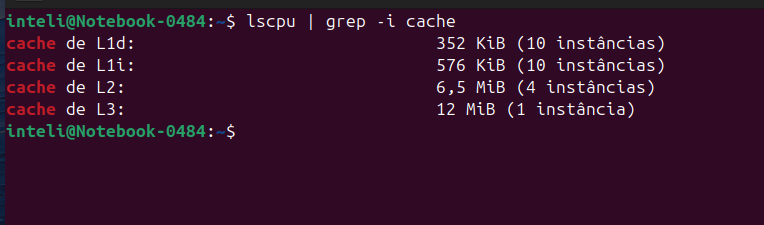
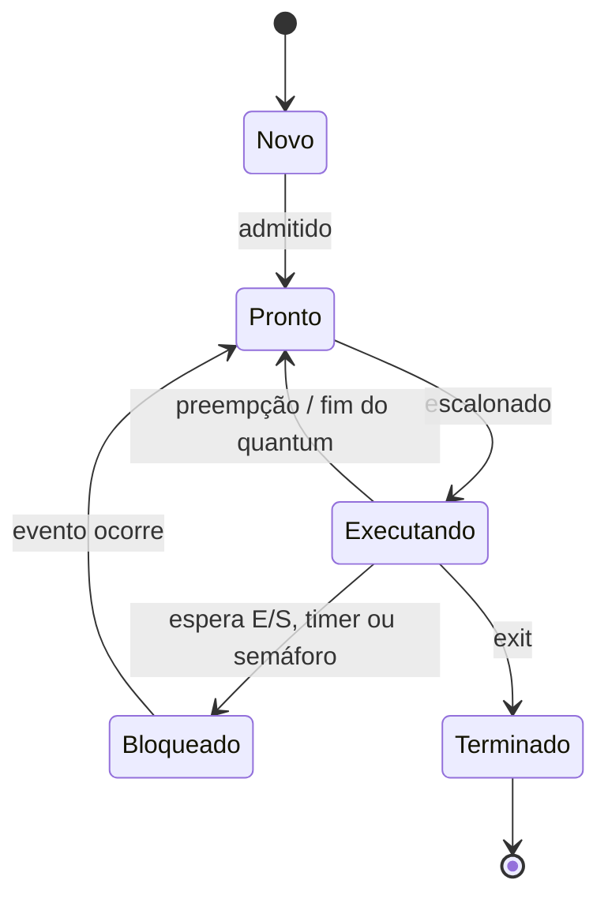
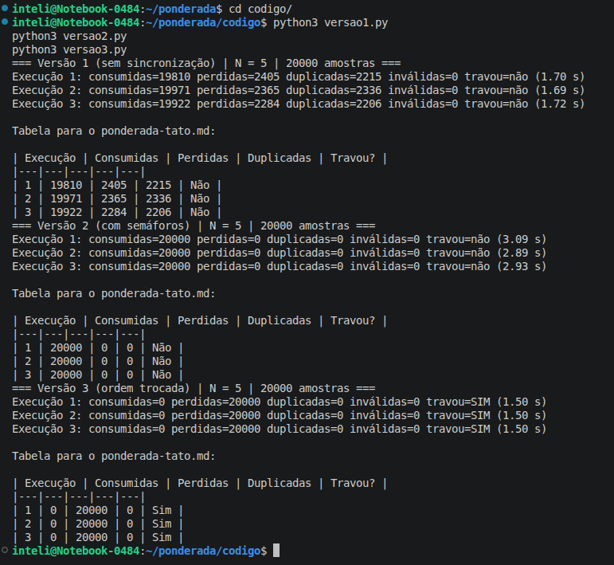
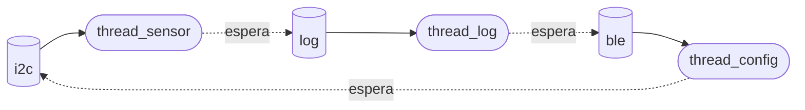

# Ponderada CC08 - Caroline Moraes Paz | D1 = 8 | D2 = 7 | N = 5

Cálculo dos parâmetros: Caroline = 8, Moraes = 6, Paz = 3.

$$
\begin{aligned}
D_1 &= \text{letras do primeiro nome} = \mathbf{8} \\
\text{Total} &= 8 + 6 + 3 = 17 \;\Rightarrow\; D_2 = \text{último dígito} = \mathbf{7} \\
N &= 3 + (D_2 \bmod 5) = 3 + (7 \bmod 5) = 3 + 2 = \mathbf{5} \\
IC &= 100.000 + 20.000 \times 7 = \mathbf{240.000}\ \text{instruções por amostra} \\
m &= 3\% + 0{,}5\% \times 8 = \mathbf{7\%}
\end{aligned}
$$


## Parte A

### A1. Arquitetura e memória

**1. Plataforma H**

$$
T = \frac{IC \times CPI}{f} = \frac{240.000 \times 1{,}5}{48 \times 10^{6}\ \text{Hz}} = \frac{360.000}{48.000.000} = \mathbf{7{,}5\ ms}
$$

$7{,}5\ \text{ms} > 5\ \text{ms}$ → **não atende** o requisito.

**2. Plataforma V**

$$
\text{AMAT} = t_{\text{acerto}} + m \times \text{penalidade} = 1 + 0{,}07 \times 120 = 1 + 8{,}4 = \mathbf{9{,}4\ ciclos}
$$

$$
CPI_{\text{efetivo}} = 1{,}0 + (1{,}3 \times 0{,}07 \times 120) = 1{,}0 + 10{,}92 = \mathbf{11{,}92}
$$

$$
T_{\text{médio}} = \frac{240.000 \times 11{,}92}{1{,}2 \times 10^{9}\ \text{Hz}} = \frac{2.860.800}{1.200.000.000} = \mathbf{2{,}384\ ms}
$$

$$
T_{\text{pior}} = 2{,}384\ \text{ms} + \underbrace{3\ \text{ms}}_{\text{atraso do Linux}} = \mathbf{5{,}384\ ms}
$$

Na média atende, mas no pior caso $5{,}384\ \text{ms} > 5\ \text{ms}$ → **não atende**. Como o requisito é de segurança, vale o pior caso.

**3. Plataforma H com acelerador DSP (Lei de Amdahl)**

Fração acelerada $f = 0{,}6$; aceleração $s = 5$

$$
\text{Speedup} = \frac{1}{(1 - f) + \dfrac{f}{s}} = \frac{1}{0{,}4 + \dfrac{0{,}6}{5}} = \frac{1}{0{,}4 + 0{,}12} = \frac{1}{0{,}52} \approx \mathbf{1{,}92}
$$

$$
T_{\text{novo}} = \frac{7{,}5\ \text{ms}}{1{,}923} = 7{,}5 \times 0{,}52 = \mathbf{3{,}9\ ms}
$$

$3{,}9\ \text{ms} < 5\ \text{ms}$ → **atende**, com 1,1 ms de folga e sem atraso de sistema operacional.

**4. Por que a V precisa de cache e a H não**

Na V (Von Neumann), instruções e dados dividem o mesmo barramento e a mesma DRAM externa, de 120 ciclos por acesso: esse é o gargalo de Von Neumann.  
Sem cache, o CPI seria $1 + 1{,}3 \times 120 = 157$ e a amostra levaria $\dfrac{240.000 \times 157}{1{,}2 \times 10^{9}} = 31{,}4\ \text{ms}$.  
A cache guarda perto da CPU o que é reusado e esconde essa latência.  
Na H (Harvard), instruções e dados têm caminhos separados e a SRAM interna responde em 1 ciclo a 48 MHz.  
Não há gargalo a esconder, então a cache não é necessária.

**5. Evidência da minha máquina**



```
cache de L1d:   352 KiB (10 instâncias)
cache de L1i:   576 KiB (10 instâncias)
cache de L2:    6,5 MiB (4 instâncias)
cache de L3:    12 MiB (1 instância)
```

A saída do `lscpu` mostra a L1 dividida: L1d (dados) com 352 KiB e L1i (instruções) com 576 KiB, em 10 instâncias (uma por núcleo). Já a L2 (6,5 MiB) e a L3 (12 MiB) são unificadas, assim como a RAM.

Portanto meu computador é **Harvard modificada**: no nível mais próximo da CPU, instruções e dados têm caminhos separados (Harvard), o que permite buscar uma instrução e um dado no mesmo ciclo. Mas a partir da L2 tudo fica numa memória única, e o programa e os dados moram na mesma RAM, então do ponto de vista do modelo de memória ele continua sendo **Von Neumann**. A L1 dividida é justamente uma forma de aliviar o gargalo de Von Neumann descrito no item 4.


### A2. Pipeline: o loop do filtro

**1. Dependências de dados (RAW)**

| Produtora | Consumidora | Registrador | Tipo |
|---|---|---|---|
| 1 (`lw x5`) | 2 (`add`) | x5 | load-use |
| 3 (`lw x7`) | 4 (`sub`) | x7 | load-use |
| 2 (`add x6`) | 4 (`sub`) | x6 | ALU → ALU |
| 4 (`sub x6`) | 5 (`sw`) | x6 | ALU → store |

Também existem dependências WAR (não são RAW): a instrução 1 lê x10 e a 6 escreve x10; a 3 lê x11 e a 7 escreve x11. Elas não geram bolha num pipeline em ordem, mas impedem que as `addi` subam para antes dos `lw` numa reordenação.

**2. Sem forwarding**

Como o banco de registradores escreve na primeira metade do ciclo e lê na segunda, o ID do consumidor pode acontecer no mesmo ciclo do WB do produtor. Cada dependência gera 2 ciclos de parada (s).

| Instr. | 1 | 2 | 3 | 4 | 5 | 6 | 7 | 8 | 9 | 10 | 11 | 12 | 13 | 14 | 15 | 16 | 17 |
|---|---|---|---|---|---|---|---|---|---|---|---|---|---|---|---|---|---|
| 1 lw x5 | IF | ID | EX | MEM | WB | | | | | | | | | | | | |
| 2 add | | IF | s | s | ID | EX | MEM | WB | | | | | | | | | |
| 3 lw x7 | | | | | IF | ID | EX | MEM | WB | | | | | | | | |
| 4 sub | | | | | | IF | s | s | ID | EX | MEM | WB | | | | | |
| 5 sw | | | | | | | | | IF | s | s | ID | EX | MEM | WB | | |
| 6 addi x10 | | | | | | | | | | | | IF | ID | EX | MEM | WB | |
| 7 addi x11 | | | | | | | | | | | | | IF | ID | EX | MEM | WB |

O `sub` espera o x7 do `lw` (WB no ciclo 9); o x6 do `add` já estava escrito no ciclo 8.

**Total: 17 ciclos** (7 instruções + 4 de preenchimento = 11 ideais, mais 6 ciclos de parada).

**3. Com forwarding**

| Instr. | 1 | 2 | 3 | 4 | 5 | 6 | 7 | 8 | 9 | 10 | 11 | 12 | 13 |
|---|---|---|---|---|---|---|---|---|---|---|---|---|---|
| 1 lw x5 | IF | ID | EX | MEM | WB | | | | | | | | |
| 2 add | | IF | ID | s | EX | MEM | WB | | | | | | |
| 3 lw x7 | | | | IF | ID | EX | MEM | WB | | | | | |
| 4 sub | | | | | IF | ID | s | EX | MEM | WB | | | |
| 5 sw | | | | | | | IF | ID | EX | MEM | WB | | |
| 6 addi x10 | | | | | | | | IF | ID | EX | MEM | WB | |
| 7 addi x11 | | | | | | | | | IF | ID | EX | MEM | WB |

**Total: 13 ciclos** (11 ideais + 2 bolhas).

As dependências ALU → ALU (2→4) e ALU → store (4→5) são resolvidas pelo forwarding. Continuam causando bolha as dependências **load-use** (1→2 por x5 e 3→4 por x7): o `lw` só obtém o dado no **fim** do estágio MEM, e o consumidor precisa dele no **início** do seu EX, que cairia no mesmo ciclo. O forwarding não consegue enviar um dado para trás no tempo, então é necessária 1 bolha em cada caso.

**4. Reordenação sem bolhas**

Trocando as instruções 2 e 3, os dois `lw` ficam juntos e cada um passa a estar a 2 instruções do seu consumidor. O forwarding MEM/WB → EX resolve sem parada.

```
1 lw   x5, 0(x10)   # lê a amostra nova
2 lw   x7, 0(x11)   # lê a amostra mais antiga
3 add  x6, x6, x5   # soma += nova
4 sub  x6, x6, x7   # soma -= antiga
5 sw   x6, 0(x12)   # grava a soma
6 addi x10, x10, 4  # avança o ponteiro da nova
7 addi x11, x11, 4  # avança o ponteiro da antiga
```

| Instr. | 1 | 2 | 3 | 4 | 5 | 6 | 7 | 8 | 9 | 10 | 11 |
|---|---|---|---|---|---|---|---|---|---|---|---|
| lw x5 | IF | ID | EX | MEM | WB | | | | | | |
| lw x7 | | IF | ID | EX | MEM | WB | | | | | |
| add | | | IF | ID | EX | MEM | WB | | | | |
| sub | | | | IF | ID | EX | MEM | WB | | | |
| sw | | | | | IF | ID | EX | MEM | WB | | |
| addi x10 | | | | | | IF | ID | EX | MEM | WB | |
| addi x11 | | | | | | | IF | ID | EX | MEM | WB |

**Total: 11 ciclos**, o mínimo possível. O resultado não muda: a soma continua sendo soma + nova − antiga, os `lw` ainda leem x10 e x11 antes de as `addi` os alterarem, e o `sw` grava o mesmo valor.


### A3. Processos e threads

**1. Organização proposta**

| Tarefa | Organização | Motivo |
|---|---|---|
| Ler o sensor | Thread do processo principal | Caminho crítico; produz amostras para o buffer compartilhado |
| Processar a amostra | Thread do processo principal | Caminho crítico; lê e escreve o mesmo buffer |
| Acionar o motor | Thread do processo principal | Caminho crítico; consome o resultado do processamento |
| BLE (log e comandos) | **Processo separado** | Não é crítico e recebe dados de fora |

- **Compartilhamento de memória:** sensor, processamento e motor trocam uma amostra a cada 10 ms com prazo de 5 ms. Como threads, usam o mesmo buffer circular protegido por semáforos, sem copiar dados entre espaços de endereçamento. O BLE só precisa de um resumo (log) e de mandar comandos ocasionais, então uma fila de IPC (pipe ou socket local) basta, e o atraso extra não afeta a segurança.
- **Custo de criação e troca de contexto:** trocar entre threads do mesmo processo não troca a tabela de páginas nem invalida a TLB, o que é mais barato. Isso importa para as três tarefas que alternam a cada amostra. O BLE roda raramente, então o custo maior de troca entre processos é aceitável.
- **Isolamento de falhas:** se uma das três tarefas críticas falhar, a pulseira para de funcionar de qualquer jeito, já que uma não serve sem as outras; juntá-las não aumenta o risco. Já uma falha no BLE (bug na pilha Bluetooth ou mensagem malformada) não pode derrubar a vibração. Como processo separado, se ele cair, só se perde o log, e o processo principal continua (e pode reiniciá-lo).

**2. BLE como thread ou como processo, se for explorado**

- **Como thread:** o invasor ganha acesso a todo o espaço de endereçamento do processo principal. Ele pode ler e alterar as amostras, mandar o motor ficar parado ou vibrar errado, corromper o buffer ou simplesmente derrubar o processo. Para a pessoa, isso significa andar sem aviso de obstáculo, ou com avisos falsos.
- **Como processo separado:** a MMU e o SO isolam a memória, então o invasor fica preso ao processo BLE. Ele só consegue mandar mensagens pela IPC, que o processo principal valida antes de aceitar (por exemplo, rejeitando parâmetros fora da faixa). O processo BLE ainda pode rodar com um usuário sem privilégios. O pior caso passa a ser perder o log ou a configuração remota, não a função de segurança.

**3. Diagrama de estados de um processo**



A thread do sensor passa a maior parte do tempo em **Bloqueado**. Ela só tem trabalho uma vez a cada 10 ms, e a leitura em si dura uma fração pequena desse período. No resto do tempo, ela está dormindo à espera do timer ou da interrupção de "dado pronto" do barramento I2C, ou esperando no semáforo `vazio` quando o buffer está cheio. Ela não fica em Pronto porque não disputa a CPU enquanto espera, e só fica em Executando durante a leitura.

### A4. Código com semáforos

Código em `/ponderada/codigo` (Python 3, `threading`). Buffer circular com N = 5 posições, 20.000 amostras por execução, 3 execuções por versão. "Perdidas" são amostras de 0 a 19.999 que nunca chegaram ao consumidor; "duplicadas" são leituras repetidas de uma amostra que já tinha chegado. Instruções para rodar no `README.md`.

**Versão 1: sem sincronização**

| Execução | Consumidas | Perdidas | Duplicadas | Travou? |
|---|---|---|---|---|
| 1 | 19.810 | 2.405 | 2.215 | Não |
| 2 | 19.971 | 2.365 | 2.336 | Não |
| 3 | 19.922 | 2.284 | 2.206 | Não |



**Versão 2: com semáforos**

| Execução | Consumidas | Perdidas | Duplicadas | Travou? |
|---|---|---|---|---|
| 1 | 20.000 | 0 | 0 | Não |
| 2 | 20.000 | 0 | 0 | Não |
| 3 | 20.000 | 0 | 0 | Não |


**Versão 3: ordem trocada**

| Execução | Consumidas | Perdidas | Duplicadas | Travou? |
|---|---|---|---|---|
| 1 | 0 | 20.000 | 0 | Sim |
| 2 | 0 | 20.000 | 0 | Sim |
| 3 | 0 | 20.000 | 0 | Sim |


**Região crítica da versão 1 e por que ela perde ou duplica amostras**

A região crítica é a atualização do contador compartilhado (`valor = contador`, `sleep(0)`, `contador = valor ± 1`), junto com os acessos ao buffer que dependem dele. A atualização não é atômica: se o produtor lê o contador, é interrompido, e o consumidor o decrementa nesse meio-tempo, o produtor escreve o valor antigo + 1 e o decremento do consumidor se perde (ou o contrário). O contador deixa de refletir o buffer real:

- quando ele fica **menor** que o real, o produtor acha que há espaço e sobrescreve uma amostra que o consumidor ainda não leu: **amostra perdida**;
- quando ele fica **maior** que o real, o consumidor acha que há amostra nova e relê uma posição antiga: **amostra duplicada**.

Nas três execuções, cerca de 12% das amostras se perderam (2.284 a 2.405) e um número parecido foi duplicado (2.206 a 2.336), o que mostra que o contador errou nos dois sentidos. As contas fecham: na execução 1, $19.810 - 2.215 = 17.595$ amostras distintas e $20.000 - 17.595 = 2.405$ perdidas. Nenhuma execução travou, mas o erro é silencioso: na pulseira, o motor vibraria com distâncias velhas e deixaria de receber cerca de 1 em cada 8 leituras, sem nenhum aviso.

**O que cada semáforo garante na versão 2**

- **vazio (começa em N = 5):** conta as posições livres. O produtor faz wait(vazio) antes de escrever, então nunca sobrescreve uma amostra não lida. Elimina as perdas.
- **cheio (começa em 0):** conta as amostras disponíveis. O consumidor faz wait(cheio) antes de ler, então nunca lê uma posição vazia ou já consumida. Elimina as duplicações.
- **mutex (começa em 1):** garante exclusão mútua: só uma thread por vez mexe no buffer e nos índices `entrada`/`saida`. Mesmo com o `sleep(0)` mantido dentro da região crítica, a outra thread não entra no meio.

O resultado foi 20.000 amostras consumidas, sem perdas nem duplicações, nas três execuções. O custo foi tempo: cerca de 2,9 s contra 1,7 s da versão 1, porque as threads agora esperam umas pelas outras.

**O que aconteceu na versão 3 e por quê**

As três execuções travaram com 0 amostras consumidas. O produtor fez wait(mutex) e depois wait(vazio). Ele encheu as 5 posições do buffer antes de o consumidor ler a primeira, então vazio chegou a 0 e o produtor dormiu **segurando o mutex**. O consumidor tinha amostras para ler (cheio = 5), mas precisava do mutex para entrar, e o mutex só seria liberado quando o produtor acordasse, o que só aconteceria se o consumidor liberasse uma posição. Um espera o outro para sempre: **deadlock**, detectado pelo timeout de 1 s.

A regra é: o semáforo de contagem (vazio/cheio) deve ser esperado **antes** do mutex, porque uma thread nunca deve dormir segurando o mutex. É o mesmo tipo de problema da pulseira congelada da A5.


### A5. Deadlock: a pulseira congelou

**1. Sequência que leva ao deadlock e grafo de alocação**

Cada recurso é um semáforo binário (valor inicial 1). Uma intercalação possível:

| Passo | Thread | Operação | Resultado |
|---|---|---|---|
| 1 | thread_sensor | P(i2c) | consegue; i2c = 0 |
| 2 | thread_log | P(log) | consegue; log = 0 |
| 3 | thread_config | P(ble) | consegue; ble = 0 |
| 4 | thread_sensor | le_sensor(); P(log) | **bloqueia**: log está com thread_log |
| 5 | thread_log | le_log(); P(ble) | **bloqueia**: ble está com thread_config |
| 6 | thread_config | recebe_comando(); P(i2c) | **bloqueia**: i2c está com thread_sensor |

Nenhuma thread chega a um V(), então ninguém libera nada. A pulseira só volta quando é desligada.

Grafo de alocação nesse instante (seta sólida: recurso alocado à thread; seta tracejada: thread esperando o recurso):



O ciclo thread_sensor → log → thread_log → ble → thread_config → i2c → thread_sensor fecha o deadlock. Como cada recurso tem uma única instância, o ciclo é condição suficiente.

**2. As quatro condições necessárias**

| Condição | Como aparece no código |
|---|---|
| **Exclusão mútua** | Cada recurso é um semáforo binário: só uma thread usa o barramento I2C, o arquivo de log ou o rádio BLE por vez. |
| **Posse e espera** | Cada thread segura o primeiro recurso enquanto pede o segundo: o thread_sensor faz P(i2c) e, sem soltá-lo, P(log); o mesmo vale para as outras duas. |
| **Não preempção** | Um semáforo não pode ser tomado de quem o segurou; só a própria thread libera com V(). O SO não tira o i2c do thread_sensor para entregar ao thread_config. |
| **Espera circular** | thread_sensor espera log (com thread_log), que espera ble (com thread_config), que espera i2c (com thread_sensor). |

**3. Duas correções**

**Correção 1 (prevenção): eliminar a posse e espera**

Nenhuma thread precisa segurar dois recursos ao mesmo tempo. Basta copiar o dado para uma variável local e liberar o primeiro recurso antes de pedir o segundo:

```
thread_sensor:        thread_log:           thread_config:
P(i2c)                P(log)                P(ble)
d = le_sensor()       l = le_log()          c = recebe_comando()
V(i2c)                V(log)                V(ble)
P(log)                P(ble)                P(i2c)
registra(d)           envia(l)              ajusta_sensor(c)
V(log)                V(ble)                V(i2c)
```

Sem posse e espera, o deadlock fica impossível. Considerei a outra prevenção clássica, a ordem global dos recursos (i2c < log < ble), mas ela obrigaria o thread_config a pegar o i2c antes do ble e segurar o barramento do sensor enquanto espera um comando do celular, que pode demorar segundos. O sensor ficaria parado e o prazo de 5 ms seria estourado.

*Para quem usa a pulseira:* nada visível muda, e o congelamento simplesmente deixa de acontecer. O custo é técnico: uma cópia do dado a cada operação e uma pequena janela em que o comando recebido ainda não foi aplicado, o que não afeta a segurança.

**Correção 2 (detecção e recuperação): watchdog**

Cada thread crítica "alimenta" um watchdog de hardware a cada ciclo. Se o watchdog ficar sem ser alimentado por um tempo limite (por exemplo, algumas amostras seguidas sem processamento), ele conclui que o sistema travou e reinicia a pulseira automaticamente. No software, os P() também podem usar espera com timeout, para que a thread que não conseguir o recurso registre o problema no log.

*Para quem usa a pulseira:* o deadlock continua podendo acontecer, mas a pessoa não precisa mais desligar e ligar. Ela fica alguns segundos sem vibração durante a reinicialização, e é importante avisar com um padrão de vibração próprio (por exemplo, um pulso longo), para ela saber que está temporariamente sem proteção e parar de andar. É uma solução mais rápida de implantar, mas que aceita uma falha curta em vez de eliminá-la.

## Parte B: memorando ao conselho

**Para:** Conselho da Tato
**De:** Caroline Moraes Paz, CTO
**Assunto:** Processador da pulseira para produção (Dilema 2)

**Decisão: a pulseira vai para a produção com a Plataforma H (microcontrolador Harvard) com o acelerador DSP, a R$ 37 por unidade.**

**Por quê.** O requisito que não se negocia é processar cada amostra em até 5 ms. Com os parâmetros da nossa carga (240.000 instruções por amostra), a Plataforma H com DSP leva 3,9 ms, sempre: não há sistema operacional nem cache, então o tempo é previsível e sobra 1,1 ms de folga. A Plataforma V é mais rápida na média (2,384 ms), mas o Linux pode interromper a tarefa por até 3 ms, e no pior caso ela chega a 5,384 ms. Para quem não enxerga, a média não importa: uma amostra atrasada é um obstáculo que não vibrou. Esse número decidiu a escolha. Sem o DSP, a H também falharia (7,5 ms), por isso o acelerador não é opcional.

**Do que estou abrindo mão.** Da atualização pela internet (OTA) e do ecossistema do Linux. A H só recebe firmware por cabo, na assistência técnica. Se descobrirmos um bug em campo, como o deadlock que congelou a pulseira, a correção depende de cada usuário ir até a assistência. Quem paga esse custo é, primeiro, o usuário, que fica sem a pulseira durante o reparo e precisa se deslocar; depois, a empresa, com logística e atendimento. Em troca, economizamos R$ 33 por unidade (R$ 37 contra R$ 70), cerca de R$ 66.000 nas primeiras 2.000 pulseiras, valor que proponho reservar para um programa de troca e atualização em campo.

**Impacto no usuário e risco de segurança.** Para quem usa, a H entrega o que importa: aviso de obstáculo no prazo, sempre, e menos consumo de bateria por rodar a 48 MHz. O risco de segurança fica menor em superfície, já que não há sistema operacional, serviços de rede ou atualização remota que possam ser explorados, mas fica maior em tempo de resposta: o rádio BLE continua recebendo dados de fora, e se uma falha nele for descoberta não conseguiremos corrigir rapidamente. Para reduzir esse risco, o firmware vai aceitar pelo BLE só comandos de configuração validados, com faixas de valor fixas, e o caminho sensor-processamento-motor não dependerá do BLE para funcionar. Também incluiremos o watchdog e a correção de prevenção do deadlock antes do lançamento, porque um bug desse tipo não poderá ser corrigido depois sem recolher a pulseira.

**O que me faria mudar de ideia.** Se o time demonstrar, em teste de bancada com carga real, que o atraso de pior caso do sistema operacional na Plataforma V cabe em menos de 2,616 ms (o que leva o pior caso a menos de 5 ms; por exemplo, com Linux de tempo real, PREEMPT_RT), eu reabro a decisão a favor da V, porque a OTA passa a valer os R$ 33 a mais. Também revejo se, no primeiro ano, mais de 10% das pulseiras precisarem voltar à assistência para correção de firmware.
